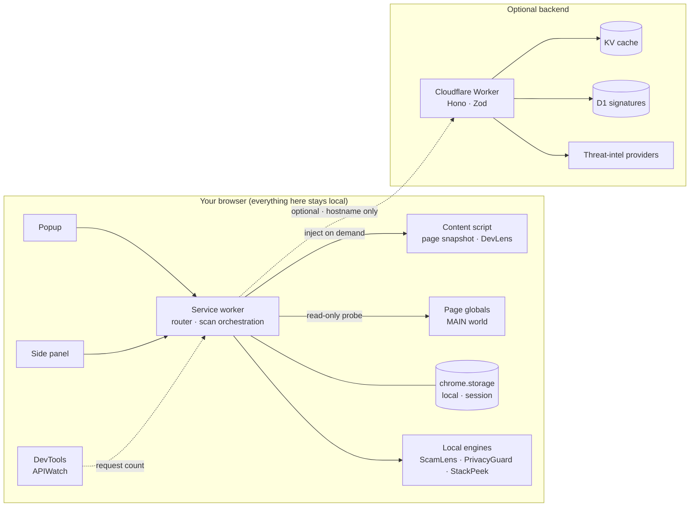

<div align="center">


# NTM Sentinel

### One browser. Complete intelligence.

Website security, privacy, tech-stack, design and API inspection in one **local-first** extension for Chrome and Edge.

[](https://github.com/abdul97233/ntm-sentinel/releases/latest)
[](#-architecture)
[](#-install)
[](#-install)
[](#-license)


[**Download**](https://github.com/abdul97233/ntm-sentinel/releases/latest) ·
[**Features**](#-five-engines-one-extension) ·
[**Install**](#-install) ·
[**Privacy**](#-privacy-by-design) ·
[**Docs**](#-documentation)

</div>

---

## ✨ Five engines, one extension

<table>
<tr>
<td width="50%" valign="top">

### 🛡️ ScamLens
**Explainable security indicators**

- Raw-IP, punycode and mixed-alphabet (homograph) domains
- Brand impersonation and look-alike typosquats
- Open-redirect parameters, `@` credential tricks, obfuscated hosts
- Password forms on HTTP or posting to another domain
- Mixed content and missing security headers
- Redirect-chain observation *(optional)*
- Cloud reputation via Safe Browsing / VirusTotal *(optional)*

<sub>Every finding shows its **evidence, explanation and recommendation**. No fake scores, and no "guaranteed safe" claims.</sub>

</td>
<td width="50%" valign="top">

### 👁️ PrivacyGuard
**Passive tracker and third-party analysis**

- Third-party domains, resource types and request counts
- ~90 classified services: analytics, ads, session replay, fingerprinting, consent
- Cookie attributes: Secure, HttpOnly, SameSite, expiry. **Never values.**
- localStorage / sessionStorage / IndexedDB summary
- Canvas, WebGL and audio fingerprinting indicators *(opt-in)*

<sub>Observation only: nothing is blocked or modified.</sub>

</td>
</tr>
<tr>
<td width="50%" valign="top">

### 🧱 StackPeek
**Evidence-based technology detection**

- ~80 signatures: React, Next.js, Vue, Nuxt, Angular, Svelte, Astro…
- WordPress, Shopify, Webflow, Drupal and other CMS / e-commerce platforms
- Tailwind, Bootstrap, jQuery, GSAP, analytics, tag managers
- Cloudflare, Vercel, Netlify, Fastly, AWS, nginx, Apache…
- **High / medium / low** confidence, versions where visible

<sub>Signatures are versioned data that can be updated without an extension release.</sub>

</td>
<td width="50%" valign="top">

### 🎨 DevLens
**Design & DOM inspector**

- Element picker with selector, box model and computed CSS
- Copy selectors, declarations and full element styles
- Page color palette in HEX / RGB / HSL
- Typography and loaded font faces
- Image, icon and font asset explorer
- Responsive preview windows with device presets
- Export **design tokens** (JSON) and **CSS variables**

</td>
</tr>
<tr>
<td colspan="2" valign="top">

### 🔌 APIWatch: a network inspector inside DevTools
Open DevTools (<kbd>F12</kbd>) → **NTM APIWatch**.

| Capture | Inspect | Export |
| --- | --- | --- |
| Live requests via the DevTools network API | Headers, query, payload, response, timing | Copy as **cURL** |
| Filter by Fetch/XHR, JS, CSS, Img, Doc | Collapsible, searchable **JSON tree** | Selected requests as **JSON** |
| Search, status, method, host, sort by duration | Pretty / raw views, image preview | **Postman** collection v2.1 |

<sub>🔒 Authorization headers, cookies and tokens are <b>redacted by default</b>, and you're warned before any export. Nothing is uploaded.</sub>

</td>
</tr>
</table>

---

## 🚀 Install

### Download a release *(fastest)*

1. Grab the zip for your browser from **[Releases](https://github.com/abdul97233/ntm-sentinel/releases/latest)** and extract it.
2. Open the extensions page:

   | Browser | Address |
   | --- | --- |
   | Google Chrome | `chrome://extensions` |
   | Microsoft Edge | `edge://extensions` |

3. Turn on **Developer mode**, click **Load unpacked**, and select the extracted folder.
4. Pin **NTM Sentinel**, open any website, and click the icon. 🎉

> Chrome Web Store and Edge Add-ons listings are in preparation. See [`docs/store`](docs/store).

### Build from source

```bash
git clone https://github.com/abdul97233/ntm-sentinel.git
cd ntm-sentinel
pnpm install
pnpm build        # → apps/extension/dist/chrome and dist/edge
pnpm package      # → release/*.zip (store-ready)
```

<details>
<summary><b>Requirements and optional backend</b></summary>

<br>

- Node.js **20.19+** and **pnpm 11**
- Chrome or Edge **116+** (needed for the side panel API)

To connect the optional cloud backend, build with its origin. Only that origin is then allowed in the extension's CSP:

```bash
NTM_API_URL=https://your-worker.example.workers.dev pnpm build
```

Backend setup is covered in [`docs/DEPLOYMENT.md`](docs/DEPLOYMENT.md).

</details>

---

## 🧭 How to use it

| Where | What you get |
| --- | --- |
| **Toolbar popup** | Instant local scan of the current page: risk level, tracker count, technology count, shortcuts to every engine |
| **Side panel** | Full dashboard with Overview · Security · Privacy · Technologies · Inspector · API Monitor · Settings |
| **DevTools panel** | APIWatch network inspector |
| <kbd>Alt</kbd> + <kbd>Shift</kbd> + <kbd>S</kbd> | Open the popup from the keyboard |

Each engine clearly shows its state: **Not scanned · Scanning · Completed · Failed · Unsupported · Permission required**.

---

## 🔒 Privacy by design

<table>
<tr>
<td>✅ Runs locally in your browser</td>
<td>✅ No site access at install</td>
<td>✅ No account</td>
</tr>
<tr>
<td>✅ No ads, analytics or telemetry</td>
<td>✅ Cookie and storage <b>values never read</b></td>
<td>✅ No remote code, strict CSP</td>
</tr>
<tr>
<td>✅ Cloud features off by default</td>
<td>✅ Hostname only, on click, if enabled</td>
<td>✅ One-click "delete all local data"</td>
</tr>
</table>

NTM Sentinel reads a page **only after you allow it**, either by clicking the toolbar icon (`activeTab`) or by granting a site. Cookies, redirect tracking and all-sites access are **optional** permissions that the extension explains before asking.

📄 [Privacy policy](docs/PRIVACY.md) · 🔑 [Permissions explained](docs/PERMISSIONS.md)

---

## 🏗️ Architecture



<details>
<summary><b>Repository layout</b></summary>

<br>

```text
ntm-sentinel/
├── apps/
│   ├── extension/        React 19 + TypeScript + Vite, Manifest V3
│   │   ├── src/background   service worker: typed router, scans, permissions
│   │   ├── src/content      on-demand page snapshot, DevLens, fingerprint monitor
│   │   ├── src/popup        toolbar popup
│   │   ├── src/sidepanel    main dashboard
│   │   ├── src/devtools     APIWatch DevTools panel
│   │   └── src/modules      scamlens · privacyguard · stackpeek · devlens · apiwatch
│   └── backend/          Cloudflare Worker: Hono, D1, KV, rate limiting
├── packages/
│   ├── shared/           types, Zod schemas, analysis engines, redaction
│   └── signatures/       versioned technology + tracker signature bundles
└── docs/                 privacy, permissions, API, deployment, store kit
```

</details>

<details>
<summary><b>Design principles</b></summary>

<br>

- **Local-first:** every engine works offline; the backend only adds optional features.
- **Explainable:** findings carry evidence, and nothing is guessed or fabricated.
- **Least privilege:** required permissions are `storage`, `activeTab`, `scripting` and `sidePanel`; the rest are opt-in.
- **Validated boundaries:** every runtime message, storage read and network response is checked with Zod.
- **Restart-safe:** the MV3 service worker keeps no in-memory state between events.

</details>

---

## 🛠️ Tech stack

| Layer | Tools |
| --- | --- |
| Extension | React 19 · TypeScript (strict) · Vite · SCSS design tokens · Lucide icons |
| Platform | Manifest V3 · Side Panel API · DevTools API · `chrome.scripting` · `chrome.storage` |
| Backend | Cloudflare Workers · Hono · D1 · KV · Workers Rate Limiting · Zod |
| Tooling | pnpm workspaces · Vitest · GitHub Actions · Wrangler |

---

## 🗺️ Roadmap

- [x] Five engines with local analysis
- [x] Popup, side panel and DevTools panel
- [x] Optional Cloudflare backend (reputation, signature updates)
- [x] Privacy policy, permissions doc and store submission kit
- [ ] Automated extension tests (unit + Playwright browser tests)
- [ ] Chrome Web Store and Edge Add-ons listings
- [ ] Screenshots and demo GIF
- [ ] Light-theme polish and accessibility audit

---

## 📚 Documentation

| Doc | Contents |
| --- | --- |
| [PRIVACY.md](docs/PRIVACY.md) | What is read, what is stored, what (optionally) leaves the device |
| [PERMISSIONS.md](docs/PERMISSIONS.md) | Every permission, why it exists, and whether it's optional |
| [API.md](docs/API.md) | Backend endpoints, schemas and error format |
| [DEPLOYMENT.md](docs/DEPLOYMENT.md) | Cloudflare D1/KV setup, secrets, CI deployment |
| [store/](docs/store) | Store listing copy and Chrome / Edge submission checklists |

---

## ⚠️ Known limitations

- **TLS certificates:** Chrome and Edge don't expose certificate details to extensions. Use the padlock menu instead.
- **APIWatch** sees only the inspected tab, and only while DevTools is open. Earlier requests have no response bodies.
- **PrivacyGuard** observes resources the page had loaded when the scan ran; service-worker traffic isn't visible.
- **Registrable domains** use a compact suffix list rather than the full Public Suffix List.

---

## 📄 License

[MIT](LICENSE). Free to use, no subscriptions, no ads.

<div align="center">
<br>
<sub><b>NTM Sentinel</b> · One browser. Complete intelligence.</sub>
</div>
